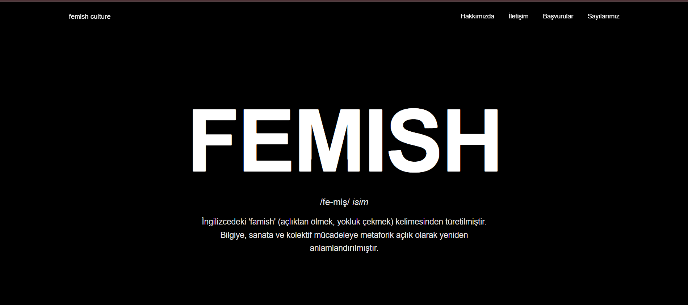
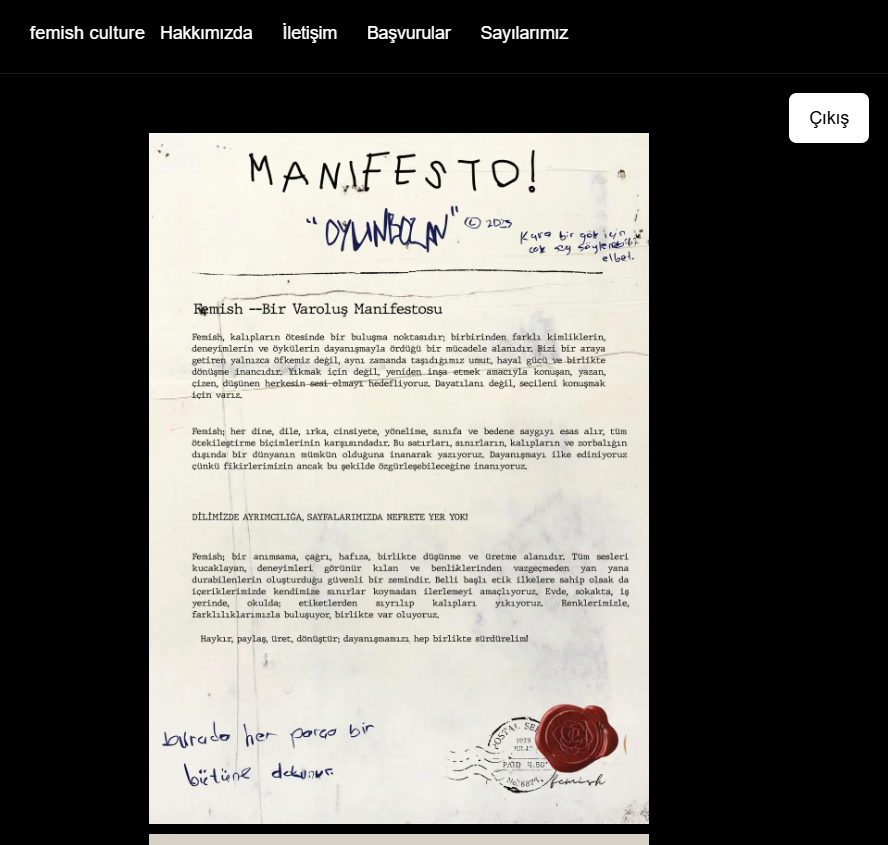
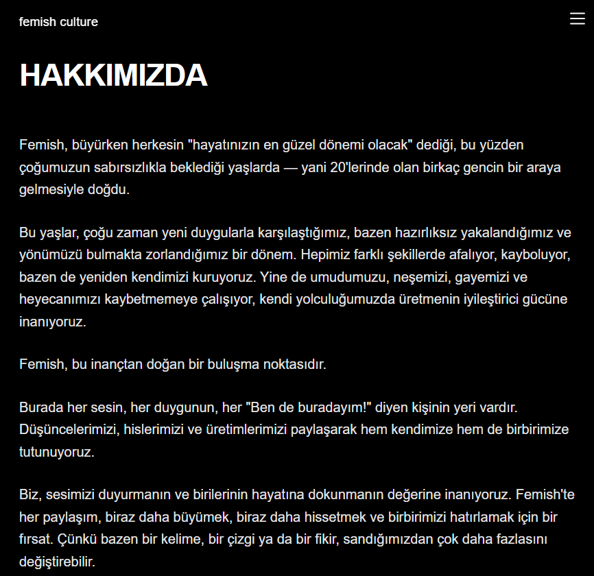

# Femish Culture — Dergi Web Sitesi

🔗 **Canlı site:** [femishculture.com](https://femishculture.com)
📦 **GitHub:** [github.com/FatmaMihranOzdemir/femish-clone](https://github.com/FatmaMihranOzdemir/femish-clone)
👩‍💻 **Geliştiren:** Fatma Mihran Özdemir



## Proje Hakkında

**Femish**, üniversite öğrencilerinin bir araya gelerek çıkardığı bağımsız bir kültür ve sanat dergisidir. Bu web sitesini, dergiye destek olmak ve onu daha geniş bir kitleye ulaştırmak amacıyla hazırladım.

Site sayesinde okurlar dergiyi indirmeden, doğrudan tarayıcı üzerinden sayfa sayfa okuyabiliyor. Ayrıca dergi ekibi hakkında bilgi alıp başvuru formuna ve sosyal medya hesaplarına ulaşabiliyor.

## Özellikler

- **Dergi okuyucu:** Femish #01'in kapağı ve 37 sayfası, site içinde açılan tam ekran bir okuyucuda gösteriliyor.
  - Fare tekerleği, dokunmatik ekran ya da sürükleyerek sayfalar arasında gezinme
  - Yakınlaştırma / uzaklaştırma
  - `ESC` tuşu ile okuyucudan çıkma
  - Kaydırmanın son sayfada durması (sayfanın altında boşluk kalmaması)
  - Kapak ve ilk sayfanın önceden yüklenmesi sayesinde hızlı açılış
- **Bölümler:** Ana sayfa, Sayılarımız, Hakkımızda, İletişim
- **Başvurular:** Dergiye katılmak isteyenler için Google Form bağlantısı
- **İletişim:** E-posta, Instagram ve TikTok bağlantıları
- **Mobil uyumlu tasarım:** Telefonda açılır hamburger menü, her ekran boyutuna uyan yazı ve görseller
- **SEO:** Sayfa başlığı, açıklama, anahtar kelimeler ve sosyal medya paylaşım kartları (Open Graph / Twitter)
- **Erişilebilirlik:** Butonlarda `aria-label` açıklamaları, klavye ile kullanılabilen okuyucu

## Kullanılan Teknolojiler

| Teknoloji | Kullanım amacı |
|---|---|
| [Next.js 16](https://nextjs.org) (App Router) | React tabanlı web çatısı |
| [React 19](https://react.dev) | Arayüz bileşenleri ve durum yönetimi (`useState`, `useEffect`, `useRef`) |
| [TypeScript](https://www.typescriptlang.org) | Tip güvenli JavaScript |
| [Tailwind CSS v4](https://tailwindcss.com) | Stil ve mobil uyumlu tasarım |
| `next/image`, `next/font` | Görsel optimizasyonu ve Geist yazı tipi |
| [Vercel](https://vercel.com) | Yayınlama (her `main` push'unda otomatik deploy) |
| Git & GitHub | Sürüm kontrolü |
| VS Code | Geliştirme ortamı (IDE) |
| v0 (Vercel), Google Gemini | Yapay zeka destekli geliştirme |

## Kurulum

Bilgisayarınızda [Node.js](https://nodejs.org) (20 veya üzeri) kurulu olmalıdır.

```bash
# 1. Depoyu klonlayın
git clone https://github.com/FatmaMihranOzdemir/femish-clone.git
cd femish-clone

# 2. Paketleri yükleyin
npm install

# 3. Geliştirme sunucusunu başlatın
npm run dev
```

Tarayıcıda [http://localhost:3000](http://localhost:3000) adresini açın.

Canlıya almadan önce üretim sürümünü denemek için:

```bash
npm run build
npm start
```

Vercel'de yayına alma adımları için: [DEPLOYMENT_GUIDE.md](DEPLOYMENT_GUIDE.md)

## Proje Yapısı

```
femish-clone/
├── app/
│   ├── layout.tsx     # Sayfa iskeleti, yazı tipleri ve SEO bilgileri
│   ├── page.tsx       # Ana sayfa, menü, bölümler ve dergi okuyucu
│   └── globals.css    # Genel stiller (Tailwind)
├── public/
│   ├── femish-logo.png
│   ├── magazine-cover.jpg      # Dergi kapağı
│   └── sayfa-1.jpg … sayfa-37.jpg  # Dergi sayfaları
├── screenshots/       # README ekran görüntüleri
├── DEPLOYMENT_GUIDE.md
└── package.json
```

## Yapay Zeka Kullanımı

Bu projeyi geliştirirken iki yapay zeka aracından yardım aldım:

- **[v0](https://v0.dev) (Vercel):** Next.js, React ve Tailwind CSS ile arayüz bileşenleri üreten yapay zeka aracı
- **[Google Gemini](https://gemini.google.com):** Kod açıklama, hata ayıklama ve öneri almak için kullandığım yapay zeka asistanı

Siteyi yayına almak için de **[Vercel](https://vercel.com)** platformunu kullandım.

### Hangi aşamada nasıl kullandım?

1. **Planlama (Gemini):** Sitenin bölümlerini (ana sayfa, sayılarımız, hakkımızda, iletişim) ve derginin site içinde nasıl gösterileceğini Gemini ile birlikte planladım.
2. **Arayüz tasarımı ve bileşen üretimi (v0):** Siyah-beyaz, sade ve büyük yazılı ana sayfa tasarımını, üst menüyü ve mobil hamburger menüyü v0'a istem yazarak oluşturdum. v0'ın ürettiği Next.js + Tailwind kodunu projeme alıp kendi tasarımıma göre düzenledim.
3. **Dergi okuyucu (v0 + Gemini):** Derginin 37 sayfasının tam ekran okunabildiği, yakınlaştırılabilen ve `ESC` ile kapanan okuyucuyu geliştirirken iki araçtan da yardım aldım.
4. **Hata ayıklama (Gemini):** Dergide aşağı kaydırınca son sayfanın altında boşluk kalması ve okuyucu açıkken arka planın kayması gibi sorunları Gemini'ye anlatarak çözdüm. Kodun ne yaptığını anlamadığım yerlerde açıklama istedim.
5. **Mobil uyum, performans ve SEO (Gemini):** Farklı ekran boyutları için Tailwind sınıfları, derginin hızlı açılması için sayfaların önceden yüklenmesi ve arama motorları için sayfa açıklamaları konusunda öneriler aldım.
6. **Yayınlama (Vercel):** Projeyi GitHub deposuna bağlayarak Vercel'de yayına aldım ve femishculture.com alan adını bağladım. Artık `main` dalına her gönderimde site otomatik olarak güncelleniyor.

Yapay zekanın ürettiği her kodu tarayıcıda test ederek doğruladım; çalışmayan ya da tasarıma uymayan kısımları yeniden istem yazarak veya elle düzelterek geliştirdim.

## Ekran Görüntüleri

| Ana sayfa | Dergi okuyucu |
|---|---|
|  |  |

| Dergiden bir sayfa | Hakkımızda (mobil görünüm) |
|---|---|
|  |  |

## İletişim

- E-posta: [femishculture@gmail.com](mailto:femishculture@gmail.com)
- Instagram: [@femish.culture](https://www.instagram.com/femish.culture)
- TikTok: [@femish.culture](https://www.tiktok.com/@femish.culture)
